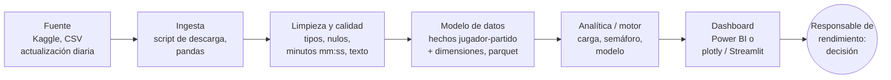

# Gestión de carga de jugadores en la NBA

**Project brief · Entrega 1 · Andrea Gutiérrez**

## 1. El dataset

### 1.1 Ficha del dataset

| Campo | Respuesta |
|---|---|
| **Nombre** | NBA Dataset: Box Scores and Stats (1947 - Today) |
| **Autor y URL** | Eoin A. Moore, en Kaggle: https://www.kaggle.com/datasets/eoinamoore/historical-nba-data-and-player-box-scores. Datos originales de NBA.com |
| **Licencia** | CC0 1.0, dominio público: https://creativecommons.org/publicdomain/zero/1.0/ |
| **Fecha de descarga y versión** | Descargado el 14/10/2026. Versión 515, actualizada el 15/06/2026 (fin de la temporada 2025-26) |
| **Grano: ¿qué es una fila?** | En `PlayerStatistics.csv`, un jugador en un partido. Comprobado: 0 parejas jugador-partido repetidas |
| **Periodo cubierto** | Del 26/11/1946 al 13/06/2026. Uso desde la temporada 2015-16 (partidos desde el 01/10/2015): 396.530 filas |
| **Tamaño** | `PlayerStatistics.csv`: 1.669.922 filas × 40 columnas, 390 MB. Además: `Games.csv` (11 MB), `TeamStatistics.csv` (36 MB) y `Players.csv` (0,5 MB) |
| **Columnas clave** | **Fechas:** `gameDate`. **Dimensiones:** jugador (`personId`), equipo, rival, local/visitante (`home`), tipo de partido (`gameType`), titular (`startingPosition`). **Medidas:** `numMinutes`, `points`, `plusMinusPoints`, tiros, rebotes, asistencias. **Objetivo candidato:** rendimiento en el siguiente partido, o ausencia por lesión (derivada de `comment`) |
| **Problemas de calidad detectados** | `numMinutes` se lee como texto (2.097 filas en formato `mm:ss`). Fechas e IDs con tipos incorrectos. `comment` y `gameType` con el mismo valor escrito de varias formas (7.891 variantes en `comment`). Nulos reales de minutos: 3,7 % de mi ventana. Al 10,4 % de los jugadores recientes le falta la fecha de nacimiento (0,2 % de las filas) |
| **Otras fuentes que uniré** | Dentro del mismo dataset: `Players.csv` (edad y posición, unida por `personId`). `TeamStatistics.csv` (balance del rival) queda para una ampliación. No necesito fuentes externas |

### 1.2 Calidad y limitaciones de los datos

El análisis completo está en [`notebooks/01-exploracion-datasetNBA.ipynb`](notebooks/01-exploracion-datasetNBA.ipynb). Los puntos principales son los siguientes:

**Problemas de calidad** (se corrigen en la limpieza)

- Los **minutos están en dos formatos** `numMinutes`, la variable principal de carga, se lee como texto porque 2.097 filas usan `mm:ss` en lugar de un número decimal. Los tendré que convertir a minutos decimales, sin eliminar las filas. 
- **Nulos estructurales** frente a **nulos reales**. El 10% de las filas no tienen minutos, pero el 89% de esos casos el jugador no jugó, lo sé porque tiene un comentario de ausencia. Los nulos reales son el 3,7% de mi ventana. El 59% de ellos son de pretemporada (que voy a excluir) y el resto tiene todas las estadísticas a 0 y se tratará como "no jugó, motivo no registrado".
- **Texto sin normalizar** `comment` tiene 7.891 variantes y `gameType` escribe el mismo tipo de  partido de varias formas (por ejemplo,`Preseason` y `Pre Season`).

**Limitaciones** (no se pueden corregir)

- **No hay datos físicos**. Sin GPS, frecuencia cardiaca ni distancia recorrida, la carga se aproxima solo con minutos y calendario. 
- **El descanso no se registra de forma fiable**. Solo 418 ausencias se etiquetan como descanso. La mayoría quedan ocultas en "Coach's Decision" (120.262 casos), que no distingue descanso de decisión técnica. Además, la etiqueta "Rest" cae a partir de 2018, coincidiendo con la normativa de la NBA contra el descanso de estrellas: **cómo se registra el dato depende de las reglas de la liga**.
- **Sesgo de selección**. Los entrenadores ya descansan a quien ven cansado, así que los datos muestran a los jugadores que *ya* se gestionaron. La relación entre carga y rendimiento será una asociación, no una causa. 

**Efecto en mi decisión:** la herramienta ofrecerá recomendaciones de apoyo, no órdenes. El responsable de rendimiento debe combinarlas con la información médica y física que el club sí tiene y el dataset no. 

## 2. El problema de negocio

### 2.1 Organización, departamento y stakeholder

**Organización:** *AGA Analytics* (inventado) es una consultora de analítica deportiva que ofrece a los clubes de NBA una herramienta de gestión de carga de jugadores, construida con datos públicos de la liga. El proyecto se presenta con un club piloto, los **Celtics**; extenderlo a otros equipos sería una ampliación posterior.

**Departamento:** El área de rendimiento y ciencia del deporte del club: un equipo reducido como por ejemplo; preparador físico, fisioterapeuta, nutricionista y un analista de datos. Estos se van a encargar de que los jugadores lleguen en buen estado a los partidos y de reducir el riesgo de lesión durante una temporada de 82 partidos en unos cinco meses y medio. 

**Stakeholder:** El responsable de rendimiento. Consulta la herramienta la víspera y la mañana de cada partido. Puede proponer que un jugador descanse, juegue con un límite de minutos o reduzca la carga en el entrenamiento. La decisión final es siempre del entrenador, así que la herramienta debe dar argumentos claros que el responsable pueda defender ante él. 

### 2.2 La decisión que apoya

**Decisión.** Con esta herramienta, el responsable de rendimiento decidirá, antes de cada partido, **qué jugadores juegan con normalidad, con un límite de minutos o descansan**, equilibrando las opciones de ganar ese partido con el desgaste acumulado de cada jugador.

**Por qué importa al club.** El objetivo estratégico de los Celtics no es ganar cada partido de temporada regular, sino llegar a los playoffs con la plantilla sana. Ahí están los ingresos y el prestigio para el club. Cada partido perdido por un descanso cuesta poco; una lesión de un titular en marzo puede costar la temporada.

**Restricciones.**

- **Normativa de la NBA.** La *Player Participation Policy* (2023) impide descansar a más de una estrella en el mismo partido y obliga a que las estrellas jueguen los partidos televisados a nivel nacional, con multas si no se cumple. Además, los jugadores necesitan 65 partidos para optar a premios individuales.
- **Datos disponibles.** Solo datos públicos: minutos, calendario y estadísticas. No hay datos médicos ni físicos (GPS, frecuencia cardiaca), que el club sí tiene pero no forman parte de este proyecto.
- **Tiempo.** La recomendación tiene que estar lista la víspera del partido, a tiempo para planificar el entrenamiento y hablar con el entrenador.
- **Quién decide.** La herramienta recomienda; la decisión final es del entrenador.

**Alternativas sin esta herramienta.**

- **El criterio del cuerpo técnico:** rápido y con información que los datos no tienen, pero subjetivo y difícil de justificar.
- **Reglas fijas** (por ejemplo, descansar a todos los veteranos en los back-to-backs): simples, pero ignoran el rival y el momento de la temporada.
- **Sensores y GPS:** más precisos, pero caros y privados. Mi herramienta los complementa, no los sustituye.

**A quién más afecta.** A los **jugadores**, cuyos minutos influyen en sus estadísticas, contratos y opciones de premios y a la **afición y las televisiones**, que pagan por ver a las estrellas; y a la **liga**, que sanciona los descansos que perjudican al espectáculo.

### 2.3 Alcance del proyecto

El planteamiento completo es amplio, así que lo divido en un **núcleo** que desarrollaré durante el curso y unas **ampliaciones** que quedan fuera por ahora. Prefiero completar y validar bien una parte que dejar varias a medias.

| Dentro del alcance (núcleo) | Fuera del alcance (ampliaciones) |
|---|---|
| Un solo equipo piloto: Boston Celtics, temporadas 2015-16 a 2025-26, partidos oficiales | Versión para cualquier equipo de la liga |
| H1 (carga → lesiones) y H2 (back-to-back → eficiencia) | Efecto de descansar según el nivel del rival (antigua H3) |
| `comment` clasificado en tres categorías: lesión, decisión técnica y otros | Clasificación detallada por tipo de lesión |
| Semáforo de carga por reglas (percentiles) | Modelo predictivo de rendimiento y simulaciones "¿qué pasa si…?" |
| 4 KPIs (sección 2.5) | KPI de victorias según el rival |

El modelo de riesgo de lesión del bloque 3 sí entra, pero como validación del semáforo: comprobará si los jugadores en rojo se lesionan más que el resto.

### 2.4 Hipótesis

Voy a ordenar las diferentes hipótesis por valor que tienen para la decisión.

**H1 - La carga acumulada aumenta el riesgo de lesión** *(prioridad alta)*

| | |
|---|---|
| **Enunciado** | Los jugadores con una carga alta en los 14 días previos tienen más probabilidad de perderse partidos por lesión en las dos semanas siguientes. |
| **Métrica** | % de jugador-partidos seguidos de una ausencia por lesión (`comment` con DND/DNP + *Injury*, *Sprain*, *Sore*…), según la carga de los 14 días previos (minutos acumulados). |
| **Dirección esperada** | El % de lesión es mayor en el tramo de carga más alto (por ejemplo, el 20 % superior de cada jugador) que en el resto. |
| **Cómo la pruebo** | Variable de ventana móvil de minutos, tasa de lesión por tramos de carga y gráfico de barras. |
| **Si se cumple** | La herramienta marca en rojo a los jugadores en el tramo alto y propone un límite de minutos antes de que llegue la lesión. |
| **Si no se cumple** | La carga en minutos no basta para anticipar lesiones; el club debe apoyarse en sus datos físicos y la herramienta se centra en el rendimiento. |

**H2 - El rendimiento cae en el segundo partido de un back-to-back, y más en los veteranos** *(prioridad media)*

| | |
|---|---|
| **Enunciado** | En el segundo de dos partidos en días consecutivos, la eficiencia en el tiro baja, sobre todo en jugadores mayores de 30 años. |
| **Métrica** | *True Shooting %* = puntos / (2 × (tiros de campo intentados + 0,44 × tiros libres intentados)), comparando al **mismo jugador** con 0 días de descanso frente a 2 o más. |
| **Dirección esperada** | Menor TS% con 0 días de descanso; diferencia mayor en los mayores de 30. |
| **Cómo la pruebo** | Variable de días de descanso (lección 05), boxplot por descanso y grupo de edad, y diferencia de medias. |
| **Si se cumple** | Límite de minutos o descanso para los veteranos en el segundo partido de cada back-to-back. |
| **Si no se cumple** | Los back-to-backs no justifican descansos por sí solos; se descansa según la carga acumulada (H1). |

**¿Por qué en este orden?** **H1** es la más valiosa porque una lesión de un titular puede costar la temporada y anticiparla es el objetivo principal del departamento. **H2** ayuda a decidir *cuándo* descansar (en los back-to-backs) y *a quién* (a los veteranos), pero solo importa si descansar evita algo: por eso depende de **H1**.

### 2.5 KPIs

| KPI | Definición y fórmula | Grano | Comparar por | Objetivo | Hipótesis | 
|---|---|---|---|---|---|
| **Carga 14 días** | Minutos jugados por el jugador en los 14 días previos al partido | Jugador x partido | Jugador, edad, posición | Semáforo según los percentiles del propio jugador: rojo por encima del percentil 80 | **H1** |
| **Ausencias por lesión** | Nº de partidos perdidos por lesión (`comment` categorizado como lesión) | Jugador x mes | Tramo de carga, edad | Reducirlas respecto a la temporada anterior | **H1** |
| **Disponibilidad de titulares** | Partidos jugados por los 5 jugadores con más minutos / partidos disputados por el equipo × 100 | Equipo × temporada (acumulado) | Jugador | ≥ 85 %; y cada estrella ≥ 65 partidos (requisito de la NBA para optar a premios) | **H1**|
| **Eficiencia tras back-to-back** | Diferencia de *True Shooting %* del jugador entre partidos con 0 días de descanso y con 2 o más | Jugador × temporada | Edad (menores / mayores de 30) | Seguimiento, sin objetivo fijo | **H2** |

**Conflicto entre KPIs.** Los indicadores tiran hacia direcciones opuestas, y gestionar esto es decisión del responsable de rendimiento: 

- **Bajar la carga** (descansar más) mejora las *ausencias por lesión*, pero puede **bajar el % de victorias** a corto plazo.
- **Descansar más** también reduce la *disponibilidad*, y la normativa exige que las estrellas jueguen al menos 65 partidos y estén en los partidos televisados. **No se puede descansar sin límite.**

El objetivo no es maximizar un KPI, sino **mantener la carga controlada sin bajar de la disponibilidad mínima**, concentrando los descansos en los jugadores en rojo y en los back-to-backs de los veteranos (**H2**).

**¿Cómo voy a presentar la carga?** Cuando en el KPI1 hablo de un semáforo es porque así es como voy a presentar la carga visualmente de cada jugador. 
El responsable de rendimiento consulta la herramienta la víspera de cada partido y tiene que revisar a toda la plantilla en pocos minutos. Por eso el KPI de carga no se muestra solo como un número, sino como un **semáforo** junto al nombre de cada jugador:

- **Verde:** la carga de los últimos 14 días está por debajo del percentil 60 de su propio historial. El jugador está en un nivel normal para él y puede jugar sin restricciones.
- **Ámbar:** la carga está entre su percentil 60 y su percentil 80. Está más cargado de lo habitual: conviene vigilarlo y, si es posible, reducir su carga en el entrenamiento.
- **Rojo:** la carga supera su percentil 80, es decir, está en uno de sus periodos más intensos de la temporada. La herramienta propone al entrenador un límite de minutos o un descanso.

Cada jugador se compara **consigo mismo** y no con el resto de la plantilla. Una estrella que siempre juega 35 minutos estaría permanentemente en rojo si se usara un umbral común, y un suplente nunca lo estaría. Con el historial propio, el rojo significa "más cargado de lo que es normal para este jugador", que es lo que de verdad indica riesgo.

Al pulsar sobre un jugador, el usuario ve el detalle: los minutos de cada partido reciente, los días de descanso y si viene de un back-to-back. Así puede justificar la recomendación ante el entrenador con datos concretos. Los cortes del 60 % y el 80 % son una propuesta inicicial que puede que cambien según el análisis avance. 

## 3. La solución

### 3.1 Tipo de solución

**Tipo: motor analítico**, con un dashboard. 

- **Inputs:** box scores de cada jugador y partidos, calendario de partidos y fecha de nacimiento de los jugadores. Todo viene del dataset descrito al inicio del brief. 

- **Lógica:** para cada jugador y partido se calculan la carga de los últimos 14 días, los días de descanso y si es un back-to-back. Ahora mismo esta lógica son reglas.((las del semáforo); en el bloque 3, un modelo de riesgo de lesión entrenado con las ausencias de `comment` servirá para validarlas.) 

- **Output:** la víspera de cada partido, una lista de la plantilla de los Boston Celtics con el semáforo de cada jugador, una recomendación (jugar normal, limitar minutos o descansar). 

**Razonamiento de la elección** 
Un dashboard solo mostraría datos y dejaría la interpretación al usuario, el responsable de rendimiento necesita una recomendación que pueda defender ante el entrenador. Una herramienta de decisión con simulaciones (*"¿qué pasa si descanso a este jugador hoy?"*) sería el siguiente paso, pero antes tenemos que hacer validaciones.

### 3.2 Del dato al resultado

Cómo se convierte cada columna del dataset en las variables del análisis y en los resultados que verá el responsable de rendimiento:

| Dato de origen | Variable que se calcula | Para qué | Resultado |
|---|---|---|---|
| `numMinutes` + `gameDate` + `personId` | Carga: minutos acumulados en los 14 días previos | KPI de carga, H1 | Semáforo por jugador antes de cada partido |
| `comment` | Ausencia por lesión (sí / no), con tres categorías | KPI de ausencias, H1 | % de lesión según el tramo de carga |
| `gameDate` | Días de descanso y back-to-back (0 días) | H2 | Diferencia de TS% con y sin descanso |
| `points`, `fieldGoalsAttempted`, `freeThrowsAttempted` | *True Shooting %* | KPI de eficiencia, H2 | Caída de eficiencia en back-to-backs |
| `birthDate` (de `Players`, unida por `personId`) | Edad en la fecha del partido | H2 | Comparación veteranos (más de 30) / jóvenes |
| `numMinutes` + `gameId` | Partidos jugados por los titulares | KPI de disponibilidad | % de partidos disponibles por temporada |

Los siguientes entregables calcularán estas variables y mostrarán los resultados reales de H1 y H2.

### 3.3 Arquitectura

| Capa | Qué hace en mi proyecto | Herramienta | Actualización |
|---|---|---|---|
| Fuente | Box scores de la NBA publicados en Kaggle | Kaggle (CSV) | Diaria durante la temporada |
| Ingesta | Descarga los 4 CSV necesarios a `data/raw/` sin modificarlos | Script de Python + API de Kaggle | Diaria, la mañana siguiente a cada jornada |
| Limpieza y calidad | Convierte minutos y fechas, unifica `gameType` y `comment`, filtra partidos oficiales desde 2015-16 | pandas (notebook de limpieza) | Tras cada ingesta |
| Modelo de datos | Tabla de hechos jugador-partido y dimensiones de jugador, equipo y fecha | Parquet en `data/processed/` | Tras cada limpieza |
| Analítica / motor | Calcula carga, descansos, semáforo y más adelante el modelo de riesgo | pandas, scikit-learn | Diaria |
| Dashboard | Semáforo de la plantilla, KPIs y detalle por jugador | Power BI o Streamlit | Diaria |

**Actualización y responsable.** Durante la temporada, el analista de datos del departamento ejecuta la cadena cada mañana después de una jornada, para que la recomendación esté lista la víspera del siguiente partido.

**Si la fuente cambia de formato.** La ingesta comprobará que existen las columnas y los tipos esperados antes de continuar. Si algo cambia, el proceso se detiene y avisa, en lugar de generar recomendaciones con datos erróneos.

**Dónde vive cada cosa.** El código (scripts y notebooks) y este documento están en mi repositorio de GitHub. Los datos están en local, en `data/raw/` y `data/processed/`, excluidos de Git por su tamaño (1,8 GB) y porque se pueden volver a descargar.

**Riesgos principales.**

1. **El dataset depende de una sola persona.** Si el autor deja de actualizarlo, la herramienta se queda sin datos. Alternativa: obtenerlos directamente de NBA.com, la fuente original.
2. **Errores al clasificar `comment`.** Con 7.891 variantes de texto, una mala clasificación de las lesiones afectaría directamente a la hipótesis H1 y al modelo.
3. **Información de salud.** Aunque los datos son públicos, deducir lesiones de personas identificables es información sensible: en la lección 03 vimos que los datos de salud son una categoría especial en el RGPD. La herramienta debe usarse solo para el cuidado de los jugadores dentro del club, no publicarse ni utilizarse, por ejemplo, en negociaciones de contratos.

## Fuentes
**Datos**

- Moore, E. A. *NBA Dataset: Box Scores and Stats (1947 - Today)*, versión 515. Kaggle. [https://www.kaggle.com/datasets/eoinamoore/historical-nba-data-and-player-box-scores](https://www.kaggle.com/datasets/eoinamoore/historical-nba-data-and-player-box-scores). Datos originales de NBA.com.
- Licencia CC0 1.0 (dominio público): [https://creativecommons.org/publicdomain/zero/1.0/](https://creativecommons.org/publicdomain/zero/1.0/)

**Normativa de la NBA sobre descansos**

- ESPN. *NBA Board of Governors approve tougher rest rule* (2023): [enlace](https://africa.espn.com/nba/story/_/id/38392750/source-nba-board-governors-approve-tougher-rest-rule)
- NBC Sports. *NBA owners approve stricter rules for resting multiple star players* (2023): [enlace](https://www.nbcsports.com/nba/news/nba-owners-approve-stricter-rules-for-resting-multiple-star-players-what-will-that-mean)
- Eurohoops. *NBPA slams Bucks over Giannis shutdown for 2025-26 NBA season*: [enlace](https://www.eurohoops.net/en/nba-news/1947670/giannis-antetokounmpo-update-nbpa-milwaukee-bucks-nba/amp/). Muestra que la normativa sigue aplicándose en la temporada 2025-26.

**Análisis propio**

- Exploración del dataset: [`notebooks/01-exploracion-datasetNBA.ipynb`](notebooks/01-exploracion-datasetNBA.ipynb)
